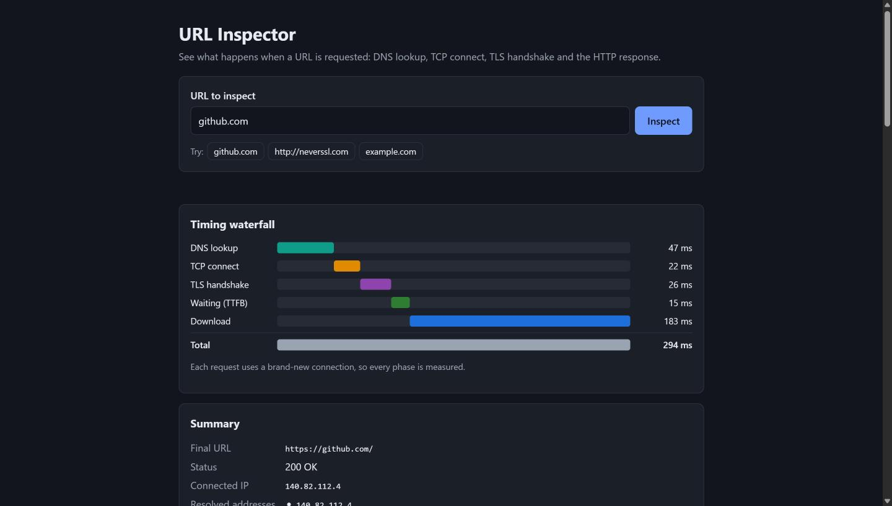

# URL Inspector

URL Inspector shows what really happens when a URL is requested. You give it a URL, and the server makes the request itself using Node's low-level `dns`, `net`, `tls`, `http` and `https` modules. It measures each phase (DNS lookup, TCP connect, TLS handshake, time to first byte and content download), follows the redirect chain hop by hop, reads the TLS certificate, and grades the response's security headers with a plain-English explanation of each one. The frontend is plain HTML, CSS and JavaScript with direct DOM manipulation. There is no framework and no build step.

**Live demo:** https://url-inspector-12i9.onrender.com (free tier, so the first load after a quiet spell can take up to a minute)



## Features

- **Phase-by-phase timing**: DNS, TCP, TLS, TTFB, download and total, drawn as a waterfall like the DevTools Network tab.
- **DNS results**: every IPv4/IPv6 address the hostname resolves to, plus the IP it actually connected to.
- **TLS certificate**: subject, alternative names, issuer, validity dates, days until expiry, TLS version, cipher, and whether it is trusted (with the reason if not: expired, self-signed or wrong host).
- **Redirect chain**: followed manually (301/302/303/307/308, up to 10 hops), with loop detection and the time each hop took.
- **Response headers**: the full list from the final response.
- **Security header grade**: a score out of 100 and a letter grade A–F for HSTS, CSP, X-Frame-Options, X-Content-Type-Options, Referrer-Policy and Permissions-Policy, with a one-sentence explanation of what each protects against.
- **Shareable results**: the URL is kept in `?url=`, and opening such a link runs the inspection automatically.

## How it works

```
 you type "example.com"
        │
        ▼
 ┌─────────────┐   ┌─────────────┐   ┌──────────────┐   ┌──────────┐   ┌──────────┐   ┌────────────┐
 │ DNS lookup  │──▶│ TCP connect │──▶│ TLS handshake│──▶│ request  │──▶│   TTFB   │──▶│  download  │
 │ name → IP   │   │ SYN/SYN-ACK │   │ (HTTPS only) │   │ GET / …  │   │ 1st byte │   │ body (≤1MB)│
 └─────────────┘   │    /ACK     │   └──────────────┘   └──────────┘   └──────────┘   └────────────┘
  dns.promises     └─────────────┘    socket event                      'response'      'end' event
  .lookup()         socket event      'secureConnect'                     event
                    'connect'
        ▲                                                                                   │
        └──────────── 3xx + Location? check the new host again and repeat ◀─────────────────┘
```

Each timestamp is taken with `process.hrtime.bigint()`. Every request uses `agent: false`, so a fresh socket is opened and no phase is skipped by keep-alive reuse.

| File | Responsibility |
|---|---|
| `src/inspector.js` | All networking: DNS, the request, timings, certificate, redirects, timeout |
| `src/ipGuard.js` | `isPrivateIp(ip)`: the SSRF block list (pure function) |
| `src/validateUrl.js` | `normalizeUrl(input)`: adds `https://` and allows only http/https |
| `src/securityHeaders.js` | `scoreHeaders(headers, isHttps)`: the security score (pure function) |
| `src/app.js` | Express routes, rate limiting, error handling (exports the app) |
| `src/server.js` | Starts the server |
| `public/` | `index.html`, `styles.css`, `app.js` |
| `scripts/try.js` | Command-line version: `node scripts/try.js github.com` |

## Run it locally

Requires Node.js 20 or newer.

```bash
git clone <your-repo-url> url-inspector
cd url-inspector
npm install
npm start
```

Open http://localhost:3000. Use `npm run dev` to restart automatically when files change.

You can also try it without the browser:

```bash
node scripts/try.js github.com
node scripts/try.js expired.badssl.com --json
```

## API

| Method | Path | Purpose |
|---|---|---|
| GET | `/api/health` | Returns `{ "status": "ok" }` |
| GET | `/api/inspect?url=<url>` | Runs the inspection |

**Responses from `/api/inspect`**

| Status | When | Body |
|---|---|---|
| 200 | Success | The full result (below) |
| 400 | Missing or invalid URL, unsupported scheme, private/internal address | `{ "error": { "message", "phase" } }` |
| 429 | More than 20 requests per minute from your IP | `{ "error": { "message" } }` |
| 502 | DNS failure, connection refused, TLS failure, timeout, redirect loop, too many redirects | `{ "error": { "message", "phase" } }` |

`phase` is one of `validate`, `dns`, `tcp`, `tls`, `ttfb`, `download` or `redirect`.

Real response for `example.com` (headers and checks shortened):

```json
{
  "input": "example.com",
  "finalUrl": "https://example.com/",
  "addresses": ["172.66.147.243", "104.20.23.154"],
  "connectedIp": "172.66.147.243",
  "dnsSkipped": false,
  "timings": { "dns": 61.8, "tcp": 24.5, "tls": 19.6, "ttfb": 17, "download": 3.1, "total": 126 },
  "status": { "code": 200, "text": "OK" },
  "redirects": [{ "url": "https://example.com/", "status": 200, "statusText": "OK", "location": null, "ms": 126 }],
  "tls": {
    "subject": "example.com", "altNames": ["example.com", "*.example.com"],
    "issuer": { "organization": "SSL Corporation", "commonName": "Cloudflare TLS Issuing ECC CA 3" },
    "validFrom": "2026-09-26T22:49:11.000Z", "validTo": "2026-12-25T22:56:35.000Z", "daysUntilExpiry": 69,
    "protocol": "TLSv1.3", "cipher": "TLS_AES_256_GCM_SHA384", "authorized": true, "error": null, "errorCode": null
  },
  "headers": { "content-type": "text/html; charset=utf-8", "transfer-encoding": "chunked" },
  "security": {
    "score": 0, "grade": "F",
    "checks": [{ "header": "Strict-Transport-Security", "present": false, "value": null, "points": 0, "max": 25,
                 "explanation": "Without Strict-Transport-Security, an attacker on the same network ...", "note": null }]
  },
  "body": { "bytes": 577, "truncated": false }
}
```

Timings are in milliseconds. `redirects` lists every hop including the final one. Timings, certificate, headers and the score all describe the **final** response.

## Tests

```bash
npm test
```

There are 58 tests (Jest + Supertest) across 6 files, and none of them uses the real internet. Integration tests start a local HTTP server that sends known headers, a 301 → 302 → 200 chain, a redirect loop, an endless redirect chain, a 2 MB body and a request that never answers. Jest's ES-module support needs `--experimental-vm-modules`, which is why `npm test` prints an "ExperimentalWarning".

## Security measures

A server that fetches any URL a user types can be turned against the network it runs in. These protections are built in:

- **SSRF protection.** Only `http:` and `https:` URLs are accepted. After DNS resolution, every address is checked by `isPrivateIp()`, and loopback, private ranges, link-local (including the cloud metadata address `169.254.169.254`), carrier-grade NAT, `0.0.0.0/8`, `::1`, `fc00::/7`, `fe80::/10` and IPv4-mapped IPv6 are refused.
- **Re-check on every redirect.** A public URL can redirect to `http://127.0.0.1/`, so the check runs again for each hop.
- **DNS rebinding protection.** The request is given a custom `lookup` function that returns the IP we already checked, so a second DNS answer cannot swap in an internal address. The original hostname is still sent in the `Host` header and as the TLS SNI `servername`.
- **XSS-safe rendering.** Header values come from external sites. The frontend builds every element with `document.createElement` and sets text with `textContent`, never `innerHTML`.
- **Rate limit.** 20 requests per minute per IP on `/api/inspect` (`express-rate-limit`). `trust proxy` is set to 3, the number of proxies measured in front of the app on Render (Cloudflare → Render load balancer → local proxy), so `req.ip` is the real client IP and can't be spoofed with a fake `X-Forwarded-For`.
- **Timeout.** The whole inspection, across all hops, has a 10-second deadline. On timeout the open socket is destroyed.
- **Body cap.** At most 1 MB of the body is read, and it is counted, not stored.
- `ALLOW_PRIVATE_HOSTS=true` turns the IP check off. It exists **only for tests** that talk to a local server. **Never set it in production.**

## Deploy to Render

This runs as **one Render Web Service**: Express serves both the API and `public/`.

1. Push this repository to GitHub.
2. On https://render.com choose **New → Web Service** and pick the repository.
3. Settings:

   | Setting | Value |
   |---|---|
   | Runtime | Node |
   | Build command | `npm install` |
   | Start command | `npm start` |
   | Health check path | `/api/health` |
   | Instance type | Free |

4. Environment variables:

   | Key | Value | Notes |
   |---|---|---|
   | `NODE_VERSION` | `20` (or newer) | Render also reads `engines` in `package.json` |
   | `PORT` | _(leave unset)_ | Render sets it, and the server reads it |
   | `ALLOW_PRIVATE_HOSTS` | _(leave unset)_ | Must never be `true` in production |

5. Deploy, then open `https://<your-service>.onrender.com/api/health` to check it's running.

**Notes**

- Timings are measured **from the server's location** (the Render region you picked), not from the user's browser. A site can be fast from Oregon and slow from Mumbai.
- Render's free tier **sleeps after about 15 minutes without traffic**. The first request after that can take 30–60 seconds while the service wakes up. Later requests are normal.

## Limitations

- Uses HTTP/1.1 only (Node's `https` module). Most browsers would use HTTP/2 or HTTP/3 with the same site, so real browser timings can differ.
- Measures from one place (the server) and sends one request, with no averaging over several runs.
- DNS time is the operating system's lookup, which may be answered from a cache. The tool does not see the resolver's work behind it (root → TLD → authoritative).
- Connects to one resolved address (IPv4 preferred). It does not race IPv4 and IPv6 the way browsers do ("Happy Eyeballs").
- Requests an uncompressed body (`Accept-Encoding: identity`), so body size is the uncompressed size.
- Only `GET` requests. No cookies, so sites that need login or a cookie banner may show a different page.
- The rate limit is stored in memory, so it resets on restart and is not shared across several instances.
- `trust proxy` is set to 3 hops to match Render. On another host (or if Render changes its setup), check the `X-Forwarded-For` chain and adjust the number.
